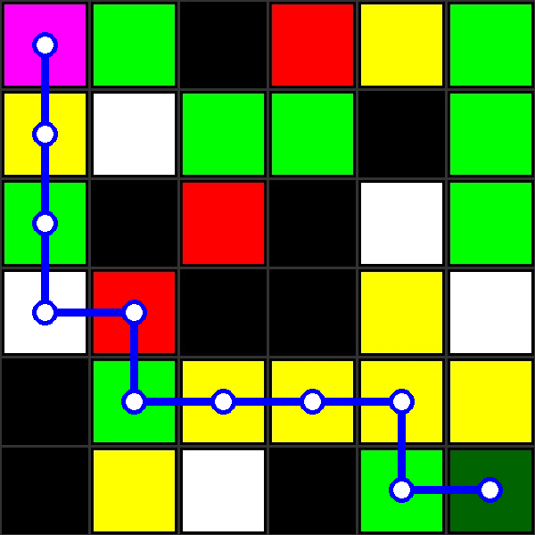
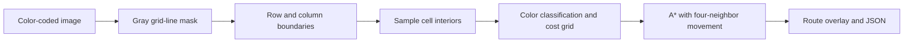

# Vision Grid Path Planner

A Python/OpenCV project that reads a color-coded grid from an image, assigns traversal costs and finds a minimum-cost route using weighted-grid A* search. It connects image processing to an explicit search problem and saves both a visual route and machine-readable results.

## Reproduced example



The supplied image produces a **6×6 grid**, with start at **(5, 5)** and destination at **(0, 0)** using zero-based `(row, column)` coordinates. The generated route takes **10 moves** with total traversal cost **23**. An independent Dijkstra search confirms the same minimum cost. Equal-cost alternative routes may exist.

The image is the supplied task example, rather than an original dataset created for this repository. The overlay above was regenerated by the current code.

## Pipeline



The grid-line detector looks for pixels with all BGR channels in 25–90, then groups rows/columns where masked pixels cover more than 80% of the image width/height. Each cell is sampled with a 10-pixel inset by default, and its mean BGR color is assigned to the nearest reference color.

| Cell type | Appearance | Entry cost |
| --- | --- | --- |
| White | White | 1 |
| Green terrain | Bright green | 2 |
| Yellow terrain | Yellow | 3 |
| Red terrain | Red | 4 |
| Start | Dark green | 0 |
| Destination | Magenta | 0 |
| Obstacle | Black | Impassable |

Only horizontal and vertical moves are allowed. Route cost sums the costs of cells entered after the start; the starting cell is excluded. The goal's entry cost is included and is zero for this palette. Minimum cost and minimum number of moves are different objectives.

## Run

Tested with Python 3.12.14. Create and activate a virtual environment, then run from the repository root:

```text
python -m pip install -r requirements.txt
python planner.py
```

To use another compatible grid image or change the output folder:

```text
python planner.py path/to/grid.jpeg --output my-results --margin 10
```

The bundled example path is resolved relative to the script, so the default example also works when launching the script from another folder. The output folder is resolved relative to the current working directory.

| Output | Contents |
| --- | --- |
| `results/path.png` | Route drawn over the input image |
| `results/grid-mask.png` | Intermediate grid-line mask |
| `results/route.json` | Classified tiles, costs, endpoints, route, move count and total cost |

No display window, camera or GUI is required. For an unreachable destination, JSON contains `reachable: false`, an empty path and `total_cost: null`; the output image has no route overlay. Invalid image/grid/marker input produces an explanatory error.

## Search implementation

The implementation uses a priority queue, accumulated entry costs, predecessor links and stale-entry skipping. Exactly one start and one destination are required by image extraction.

The heuristic accounts for the zero-cost destination. For a non-goal node at Manhattan distance `d`, it uses:

```text
h = max(d - 1, 0) * minimum_interior_cost + destination_entry_cost
```

The destination's heuristic is zero. The search skips moves back to the start: with nonnegative entry costs, a minimum-cost simple path never needs that revisit. This permits the lower bound to exclude the start's free entry. Zero-cost interior cells are supported; they can make the lower bound weaker. Negative and nonfinite costs are rejected by the search API.

## Verification

```text
python -m unittest discover -s tests -v
```

All **8 test methods passed**, including:

- The supplied image through extraction, search and saved output.
- A weighted case where the cheaper route requires more moves.
- **500 seeded random grids** compared with an independent Dijkstra implementation, including obstacles, zero-cost cells and fractional weights.
- Unreachable targets, blocked endpoints and coincident search endpoints.
- Invalid costs, coordinates, grid shapes, markers and sampling margins.

Returned paths are also checked for legal adjacent moves, traversable cells, endpoints and recomputed cost. Running the CLI from outside the repository produced an identical result JSON. See [verification notes](docs/verification.md).

## Limitations

Image extraction assumes a clean, axis-aligned grid with the expected border intensity and color palette. It does not rectify perspective, recognize arbitrary maps or learn colors. Mean-color classification always picks the closest reference and has no confidence threshold, so inspect `tiles` and `cost_grid` when using a new image. Smaller cells may require a smaller inset margin.

The search's optimality checks apply to the extracted cost grid; they do not establish correct interpretation of every possible input image. This is an image-based grid-planning exercise, with no physical robot localization, obstacle sensing or motion execution.

## Source and preparation

The original `CV.py` and RMI submission `108125067_CVxML_Task1.py` were byte-for-byte identical. One unchanged original is retained as `archive/original_cv.py`; it still contains its historical absolute input path and is not the recommended entry point.

The current `planner.py` retains the original palette, grid extraction approach, cell-entry cost convention and route-drawing style. Repository preparation adds portable CLI paths, importable functions, input validation, a destination-aware admissible heuristic, stale-entry skipping, JSON output and independent optimality checks. Original working folders were not edited. [Source hashes](docs/source-hashes.json) record the archived script and example image.
